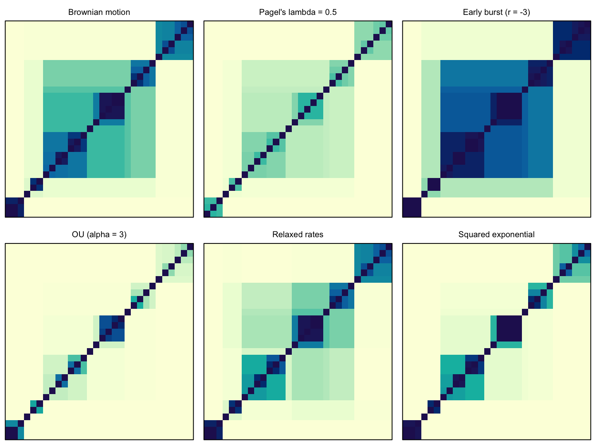
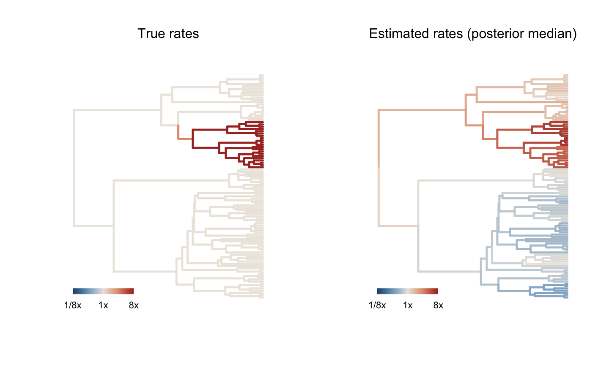

# phylogp

**Phylogenetic comparative models as Gaussian processes.**

`phylogp` fits models of continuous trait evolution as Gaussian processes on
a phylogeny. A model is a *kernel*, the covariance it implies between
species, and kernels are built by adding components:

```r
library(phylogp)

k_bm() + k_white()                          # Brownian motion + residual (= Pagel's lambda)
k_ou(root = "fixed")                        # Ornstein-Uhlenbeck
k_relaxed() + k_white()                     # autocorrelated (relaxed) rates
k_rate_time(n_bins = 20) + k_white()        # rate as a smooth function of time
k_bm() + k_dist(geo_dist) + k_white()       # phylogeny + geography
k_bm() + k_slope("body") * k_bm() + k_white()   # slopes that evolve along the tree
k_bm() + k_white(df = 4)                    # Student-t residuals
k_edge("pow(len, kappa) .* exp(beta * he)", # your own branch-wise kernel
       pars = list(kappa = c(0, 1), beta = c(-5, 5)))
```



*The same tree seen through six kernels: Brownian motion, Pagel's λ, early
burst, Ornstein–Uhlenbeck, relaxed rates and a squared-exponential kernel.*

`phylogp` writes the Stan program for the kernel, compiles it once and fits
it with [cmdstanr](https://mc-stan.org/cmdstanr/), by maximum likelihood or
HMC. Whenever every component has the branch-wise form (variance
accumulated along edges), the likelihood is evaluated by the O(N) pruning
recursion and leave-one-out predictive densities by an O(N) two-pass
message passing; otherwise it falls back to dense algebra.



*A relaxed-rate kernel finds a clade evolving 8 times faster, without being
told where it is (from `vignette("phylogp")`).*

## Designing kernels

Before fitting, check what a kernel implies and whether it is valid on your
tree:

```r
tr <- ape::rtree(50)                         # a tree with tips at different heights

kernel_check(k_dist(phi = "sqexp"), tr)      # squared exponential: can fail here
kernel_check(k_dist(phi = "exponential"), tr) # exponential (= OU): always valid

kernel_plot(k_ou(), tr, pars = list(ou1 = list(alpha = 3)))
y <- kernel_simulate(k_relaxed() + k_white(), tr)   # prior predictive draws
cat(make_stancode(k_bm() + k_white()))       # the generated Stan program
```

`kernel_check()` uses the theory first: branch-wise kernels are valid
whenever their edge variances are non-negative; on ultrametric trees any
non-increasing function of patristic distance is valid; on trees with fossil
tips or without a clock only completely monotone functions (such as the
exponential) are guaranteed. Where validity is not guaranteed it checks
numerically over a grid of parameter values.

## Fitting

```r
fit <- phylo_gp(brain ~ body, data = d, tree = tr,
                kernel = k_relaxed() + k_white())
fit
loo(fit)                      # PSIS-LOO from exact conditional densities

loo_refit(fit)                # exact LOO for influential species
predict(fit, newdata = new)   # species without data (kriging on the tree)

ml <- phylo_gp(brain ~ body, data = d, tree = tr,
               kernel = k_lambda(), method = "optimize")
logLik(ml); AIC(ml)
```

Maximum-likelihood fits of the classical kernels (BM, Pagel's lambda, kappa,
delta, early burst, OU with fixed or random root) reproduce `phylolm` to
numerical precision; this comparison is part of the test suite.

## Installation

```r
# install.packages("remotes")
remotes::install_github("ThomasPueschel/phylogp")

# fitting needs cmdstanr and CmdStan
install.packages("cmdstanr", repos = c("https://stan-dev.r-universe.dev", getOption("repos")))
cmdstanr::install_cmdstan()
```

Kernel design tools (`kernel_matrix()`, `kernel_check()`, `kernel_plot()`,
`kernel_simulate()`, `kernel_loglik()`, `make_stancode()`) work without Stan.

## Learn more

* `vignette("phylogp")`: getting started, a complete analysis of simulated
  data with a fast-evolving clade.
* `vignette("kernel-design")`: building your own kernels, checking that they
  are valid on your tree, and when two kernels are the same model.
* `vignette("slopes-prediction")`: slopes that evolve along the tree,
  influential species, predicting species without data, ancestral states,
  and robust residuals.

Install with `remotes::install_github("ThomasPueschel/phylogp", build_vignettes = TRUE)`
to have the vignettes locally.

## Status

Version 0.2.0, under development. Planned: `kernel_equivalent()` to detect
kernels that imply the same distribution for the tips (such as OU and
accelerating-rate models on ultrametric trees), fitting across a sample of
trees, multivariate kernels and non-Gaussian traits.

## Citation

Püschel, T. A. Phylogenetic comparative methods as Gaussian processes: a
kernel framework for organising and extending models of trait evolution. In
preparation.
