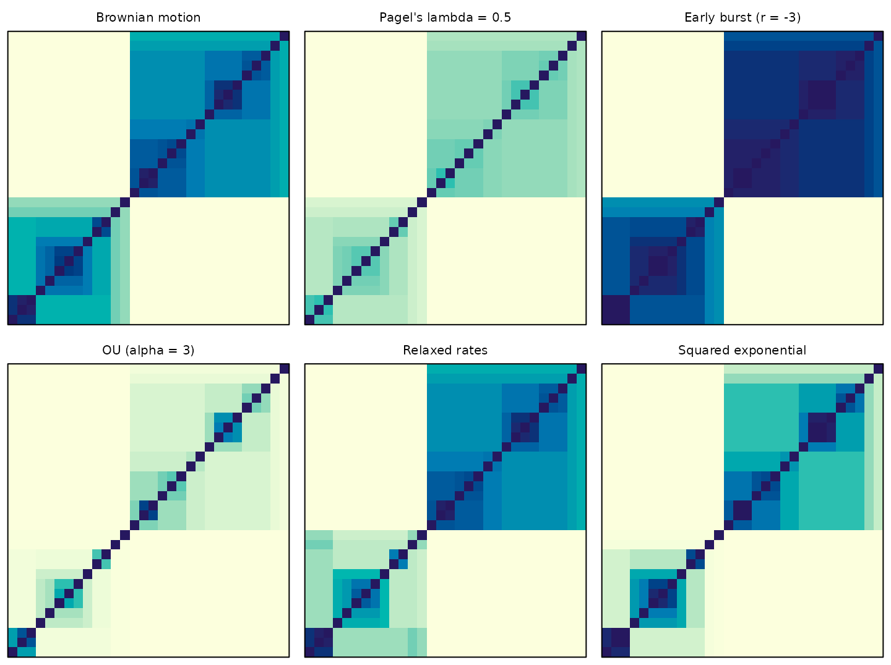
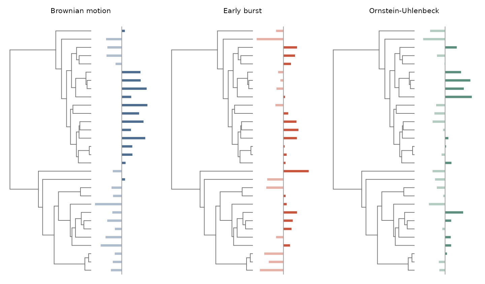
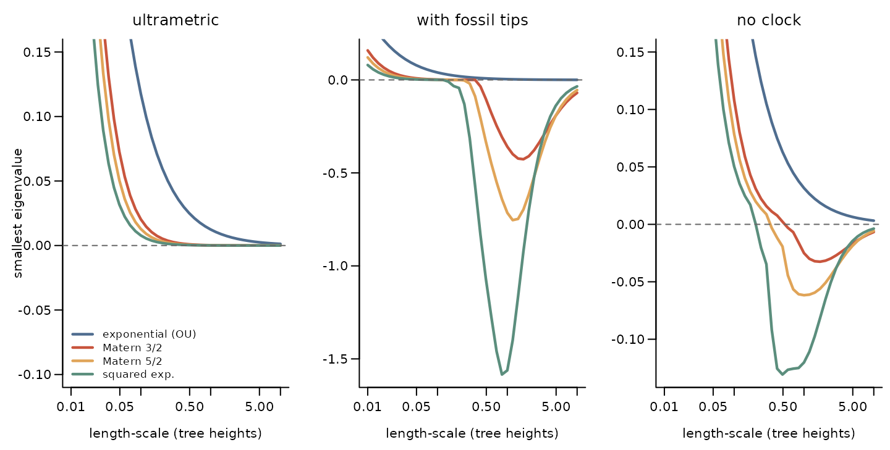
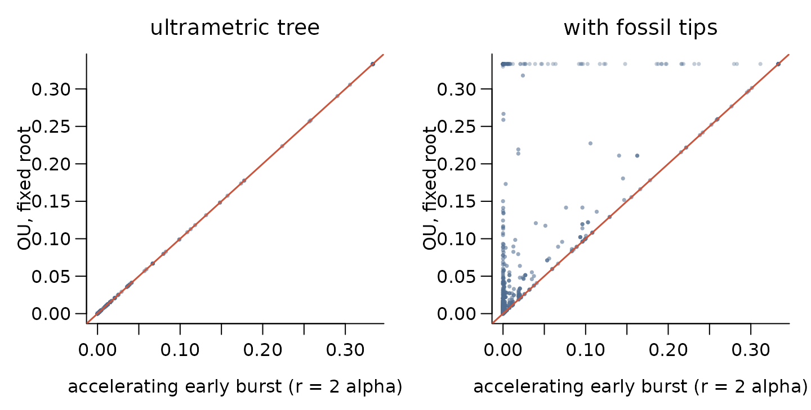
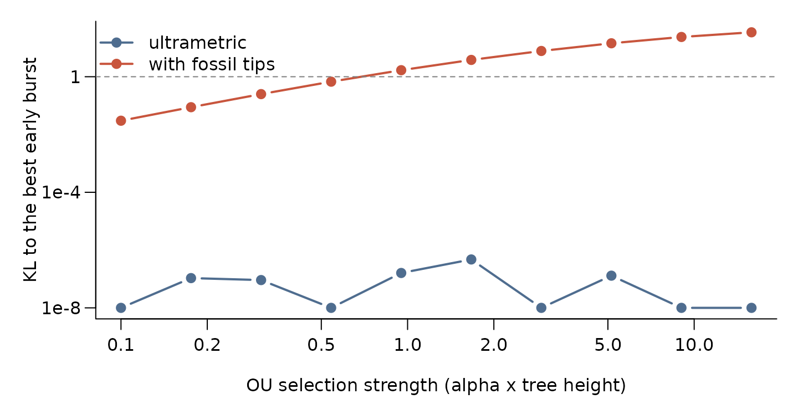
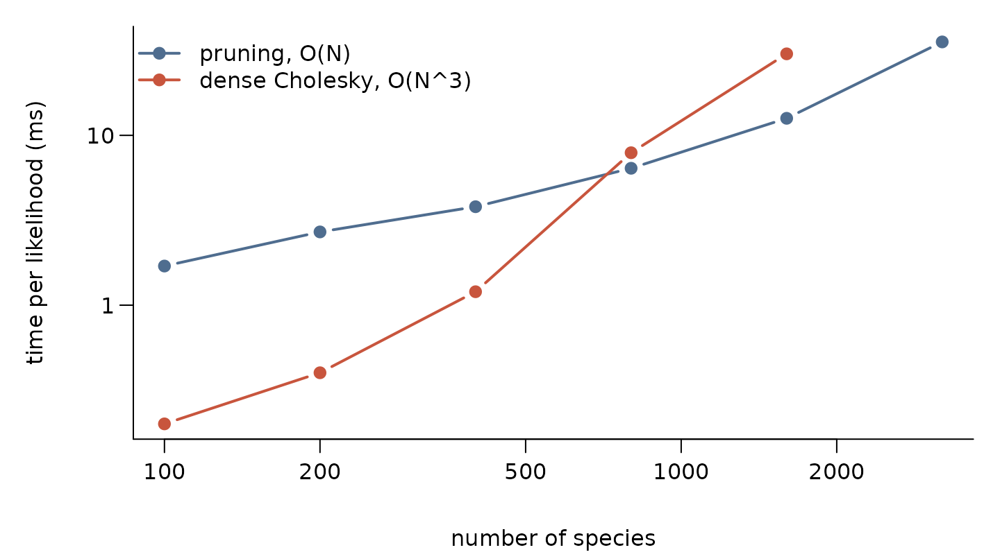

# Designing kernels

In `phylogp` a model of trait evolution *is* its kernel: the covariance
it implies between species. This vignette shows how to look at kernels,
build new ones, and check that they are valid before fitting anything.
Apart from one optional fit, nothing here needs Stan.

``` r

library(phylogp)
set.seed(12)
tr <- ape::rphylo(30, birth = 1, death = 0)      # a pure-birth tree
tr$edge.length <- tr$edge.length / max(ape::node.depth.edgelength(tr))
```

## The building blocks

The components correspond to familiar models: Brownian motion
([Felsenstein 1985](#ref-felsenstein1985)), Pagel’s transformations
([Pagel 1999](#ref-pagel1999)), early burst ([Blomberg et al.
2003](#ref-blomberg2003); [Harmon et al. 2010](#ref-harmon2010)),
Ornstein–Uhlenbeck ([Hansen 1997](#ref-hansen1997); [Butler and King
2004](#ref-butler2004)), autocorrelated rates ([Thorne and Kishino
2002](#ref-thorne2002); [Eastman et al. 2011](#ref-eastman2011);
[Venditti et al. 2011](#ref-venditti2011)) and distance-based kernels as
used for spatial structure ([Freckleton and Jetz
2009](#ref-freckleton2009); [Hartmann and Jäger
2023](#ref-hartmann2023)).
[`k_white()`](https://thomaspueschel.github.io/phylogp/reference/classical-kernels.md)
is the species-level variation of the phylogenetic mixed model ([Lynch
1991](#ref-lynch1991); [Housworth et al. 2004](#ref-housworth2004)).
Kernels are combined by sums and products, as is usual for Gaussian
processes ([Rasmussen and Williams 2006](#ref-rasmussen2006); [Duvenaud
et al. 2013](#ref-duvenaud2013)).

| Component | Kernel (before scaling by `sigma^2`) | Form |
|----|----|----|
| [`k_bm()`](https://thomaspueschel.github.io/phylogp/reference/classical-kernels.md) | shared path length $`t_{ij}`$ | branch-wise |
| [`k_lambda()`](https://thomaspueschel.github.io/phylogp/reference/classical-kernels.md) | $`\lambda t_{ij}`$, tip variance kept | branch-wise |
| [`k_kappa()`](https://thomaspueschel.github.io/phylogp/reference/classical-kernels.md) | branch lengths raised to $`\kappa`$ | branch-wise |
| [`k_delta()`](https://thomaspueschel.github.io/phylogp/reference/classical-kernels.md) | $`T^{1-\delta} t_{ij}^{\delta}`$ | branch-wise |
| [`k_eb()`](https://thomaspueschel.github.io/phylogp/reference/classical-kernels.md) | $`(e^{r t_{ij}} - 1)/r`$ | branch-wise |
| [`k_ou()`](https://thomaspueschel.github.io/phylogp/reference/classical-kernels.md) | $`e^{-\alpha d_{ij}}/2\alpha`$ (random root) | branch-wise on ultrametric trees |
| [`k_relaxed()`](https://thomaspueschel.github.io/phylogp/reference/k_relaxed.md) | rate evolves by BM along the tree | branch-wise, latent rates |
| [`k_rate_time()`](https://thomaspueschel.github.io/phylogp/reference/k_rate_time.md) | rate a smooth function of time | branch-wise, latent rates |
| [`k_white()`](https://thomaspueschel.github.io/phylogp/reference/classical-kernels.md) | independent tip variance; `df =` for Student-t | tip |
| `k_slope(x) * k` | slope on `x` evolving under `k`: $`x_i x_j k(i, j)`$ | latent (linear) or dense |
| [`k_dist()`](https://thomaspueschel.github.io/phylogp/reference/k_dist.md) | $`\phi(D_{ij}/\ell)`$ on any distance | dense |
| [`k_edge()`](https://thomaspueschel.github.io/phylogp/reference/k_edge.md) | **your own** edge variances | branch-wise |

Components are added with `+`, and a branch-wise component can be
multiplied by a covariate with
[`k_slope()`](https://thomaspueschel.github.io/phylogp/reference/k_slope.md)
(see
[`vignette("slopes-prediction")`](https://thomaspueschel.github.io/phylogp/articles/slopes-prediction.md)).
A sum describes independent processes acting together, for example
phylogeny, space and residual variation:

``` r

k_bm() + k_dist(phi = "exponential") + k_white()
#> phylogp kernel: bm() + dist(exponential) + white() 
#>   bm1        bm()                         parameters: sigma
#>   dist1      dist(exponential)            parameters: sigma, ell
#>   white1     white()                      parameters: sigma
```

*Branch-wise* components add variance along the edges of the tree. Any
sum of them keeps the linear-time pruning likelihood ([Felsenstein
1973](#ref-felsenstein1973); [Ho and Ané 2014a](#ref-ho2014)); adding a
dense component switches the model to dense linear algebra.

## A gallery of kernels

The same tree seen through six kernels. Each matrix shows the
correlation between species, with tips in tree order, so clades show up
as blocks.

``` r

# a clade of about 8 species evolving 5 times faster, for k_relaxed()
clade <- 30 + which.min(abs(lengths(ape::prop.part(tr)) - 8))
below <- function(node) c(node, unlist(lapply(tr$edge[tr$edge[, 1] == node, 2], below)))
z <- numeric(30 + tr$Nnode)
z[below(clade)] <- log(5)
gallery <- list(
  "Brownian motion"         = list(k_bm(), NULL),
  "Pagel's lambda = 0.5"    = list(k_lambda(), list(lambda1 = list(lambda = 0.5))),
  "Early burst (r = -3)"    = list(k_eb(), list(eb1 = list(rate = -3))),
  "OU (alpha = 3)"          = list(k_ou(), list(ou1 = list(alpha = 3))),
  "Relaxed rates"           = list(k_relaxed(), list(relaxed1 = list(z = z))),
  "Squared exponential"     = list(k_dist(phi = "sqexp"), list(dist1 = list(ell = 0.5)))
)
op <- par(mfrow = c(2, 3), mar = c(0.5, 0.5, 2, 0.5))
for (nm in names(gallery))
  kernel_plot(gallery[[nm]][[1]], tr, pars = gallery[[nm]][[2]],
              main = nm, show_tree = FALSE)
```



``` r

par(op)
```

## Simulating from a kernel

[`kernel_simulate()`](https://thomaspueschel.github.io/phylogp/reference/kernel_simulate.md)
draws traits from a kernel: a quick way to see what data a model expects
(a prior predictive check).

``` r

trait_plot <- function(tree, y, main, col) {
  H <- max(ape::node.depth.edgelength(tree))
  ape::plot.phylo(tree, show.tip.label = FALSE, x.lim = c(0, 1.75 * H),
                  edge.color = "grey45", main = main, cex.main = 1, font.main = 1)
  lp <- get("last_plot.phylo", envir = ape::.PlotPhyloEnv)
  tips <- seq_along(tree$tip.label)
  x0 <- 1.38 * H
  y <- y - mean(y)                      # deviations from the mean
  v <- y[tree$tip.label] / max(abs(y)) * 0.33 * H
  segments(x0, lp$yy[tips], x0 + v, lp$yy[tips], lwd = 3.5, lend = 1,
           col = ifelse(v > 0, col, adjustcolor(col, 0.45)))
  segments(x0, 0.5, x0, length(tips) + 0.5, col = "grey60")
}
set.seed(11)
op <- par(mfrow = c(1, 3), mar = c(0.5, 0.5, 2.5, 0.5))
trait_plot(tr, kernel_simulate(k_bm(), tr)[, 1], "Brownian motion", cols[1])
trait_plot(tr, kernel_simulate(k_eb(), tr, list(eb1 = list(rate = -5)))[, 1],
           "Early burst", cols[2])
trait_plot(tr, kernel_simulate(k_ou(), tr, list(ou1 = list(alpha = 6)))[, 1],
           "Ornstein-Uhlenbeck", cols[4])
```



``` r

par(op)
```

Under an early burst, differences arise deep in the tree and whole
clades differ; under strong OU selection, close relatives can differ as
much as distant ones.

## Writing your own kernel

Most new models of trait evolution are just a new rule for how much
variance each branch accumulates.
[`k_edge()`](https://thomaspueschel.github.io/phylogp/reference/k_edge.md)
takes that rule as a Stan expression of the edge length `len`, the
heights of the start and end of the edge `hs` and `he`, the indicator
`is_tip`, the tree height `Tmax`, and your own parameters. Here is
Pagel’s κ combined with a rate that changes exponentially through time:

``` r

k_trend <- k_edge("pow(len, kappa) .* exp(beta * he)",
                  pars = list(kappa = c(0, 1), beta = c(-5, 5)),
                  name = "trend")
k_trend
#> phylogp kernel: edge("pow(len, kappa) .* exp(beta * he)") 
#>   trend1     edge("pow(len, kappa) .* exp(beta * he)") parameters: sigma, kappa, beta
```

A kernel of this branch-wise form is a valid covariance on *every* tree,
as long as its edge variances are non-negative.
[`kernel_check()`](https://thomaspueschel.github.io/phylogp/reference/kernel_check.md)
verifies this over a grid of parameter values:

``` r

kernel_check(k_trend, tr)
#> Kernel check on a 30-tip ultrametric tree
#>   [valid  ] trend1     edge("pow(len, kappa) .* exp(beta * he)") (edge)
#>          branch-wise form: valid wherever all edge variances are non-negative (checked numerically); no failures at 25 parameter values tried
#> The kernel is a valid covariance on this tree.
```

A careless rule is caught:

``` r

kernel_check(k_edge("len + beta * he", pars = list(beta = c(-5, 5))), tr)
#> Kernel check on a 30-tip ultrametric tree
#>   [INVALID] edge1      edge("len + beta * he") (edge)
#>          branch-wise form: valid wherever all edge variances are non-negative (checked numerically); FAILS at 12 of 25 parameter values tried
#> The kernel is NOT guaranteed to be a valid covariance on this tree.
#> Use a branch-wise kernel or a completely monotone function of distance
#> (e.g. phi = "exponential"); adding jitter would change the model.
```

The custom kernel goes into the generated Stan program unchanged, so it
keeps the linear-time likelihood:

``` r

code <- strsplit(kernel_stancode(k_trend + k_white()), "\n")[[1]]
cat(code[grep("= trend1_kappa;", code, fixed = TRUE)[1] + (-2:3)], sep = "\n")
#>     // edge("pow(len, kappa) .* exp(beta * he)")
#>     {
#>     real kappa = trend1_kappa;
#>     real beta = trend1_beta;
#>     w += square(trend1_sigma) * (pow(len, kappa) .* exp(beta * he));
#>   }
```

and it can be fitted like any built-in kernel:

``` r

big <- ape::rcoal(150)
big$edge.length <- big$edge.length / max(ape::node.depth.edgelength(big))
y <- kernel_simulate(k_trend, big,
                     pars = list(trend1 = list(kappa = 0.6, beta = -3)))[, 1]
fit <- phylo_gp(y ~ 1, data = data.frame(y = y, row.names = names(y)),
                tree = big, kernel = k_trend, method = "optimize")
fit
#> Phylogenetic Gaussian process
#>   Formula: y ~ 1 
#>   Kernel:  edge("pow(len, kappa) .* exp(beta * he)") 
#>   Tips:    150 
#>   Likelihood: pruning (linear time) 
#>   Method:  maximum likelihood 
#> 
#>      parameter estimate
#> 1  (Intercept)    0.290
#> 2 trend1_sigma    0.507
#> 3 trend1_kappa    0.577
#> 4  trend1_beta   -1.699
#> 
#> log-likelihood: 153.24276
```

## Is my kernel valid?

A kernel must be positive semi-definite on the tips of the tree, or it
is not a covariance at all. It is tempting to plug patristic distances
into the squared-exponential kernel that most Gaussian-process software
uses by default. Whether that works depends on the tree:

- On an **ultrametric** tree any non-increasing function of patristic
  distance is valid: it is just another tree transformation (ultrametric
  matrices are positive semi-definite; Dellacherie et al.
  ([2014](#ref-dellacherie2014))).
- On trees with **fossil tips**, or phylograms without a clock, only
  *completely monotone* functions are guaranteed, such as the
  exponential, which is the Ornstein–Uhlenbeck kernel ([Schoenberg
  1938](#ref-schoenberg1938); [Feragen et al. 2015](#ref-feragen2015)).
  Squared-exponential and Matérn kernels can fail.

The smallest eigenvalue of the kernel matrix tells us directly. Below,
three trees: ultrametric, ultrametric with some tips shortened to make
them “fossils”, and a random tree without a clock.

``` r

set.seed(3)
ultra <- ape::rphylo(60, birth = 1, death = 0)
fossil <- ape::rphylo(60, birth = 1, death = 0.6, fossils = TRUE)  # keeps extinct lineages
noclock <- ape::rtree(60)
trees <- list("ultrametric" = ultra, "with fossil tips" = fossil,
              "no clock" = noclock)
sapply(trees, ape::Ntip)
#>      ultrametric with fossil tips         no clock 
#>               60              168               60

phis <- c("exponential", "matern32", "matern52", "sqexp")
ells <- 10^seq(-2, 1, length.out = 40)
min_eig <- function(tree, phi, ell) {
  K <- kernel_matrix(k_dist(phi = phi), tree, list(dist1 = list(ell = ell)))
  min(eigen(K, symmetric = TRUE, only.values = TRUE)$values)
}

op <- par(mfrow = c(1, 3), mar = c(4, 4, 2.5, 0.5), mgp = c(2.4, 0.7, 0))
for (nm in names(trees)) {
  H <- max(ape::node.depth.edgelength(trees[[nm]]))
  ev <- sapply(phis, function(p) sapply(ells * H, function(l) min_eig(trees[[nm]], p, l)))
  matplot(ells, ev, type = "l", lty = 1, lwd = 2.2, col = cols, log = "x",
          ylim = c(min(-0.1, ev), 0.15), las = 1, bty = "l", main = nm, font.main = 1,
          xlab = "length-scale (tree heights)",
          ylab = if (nm == "ultrametric") "smallest eigenvalue" else "")
  abline(h = 0, lty = 2, col = "grey40")
  if (nm == "ultrametric")
    legend("bottomleft", c("exponential (OU)", "Matern 3/2", "Matern 5/2",
                           "squared exp."), col = cols, lwd = 2.2, bty = "n", cex = 0.85)
}
```



``` r

par(op)
```

[`kernel_check()`](https://thomaspueschel.github.io/phylogp/reference/kernel_check.md)
applies these rules for you, and checks numerically where validity is
not guaranteed:

``` r

kernel_check(k_bm() + k_dist(phi = "sqexp") + k_white(), fossil)
#> Kernel check on a 168-tip non-ultrametric tree
#>   [valid  ] bm1        bm() (edge)
#>          branch-wise form with non-negative edge variances
#>   [INVALID] dist1      dist(sqexp) (dense)
#>          sqexp kernel on patristic distances of a non-ultrametric tree is not guaranteed valid; FAILS at 13 of 25 parameter values tried
#>   [valid  ] white1     white() (white)
#>          independent tip variance
#> The kernel is NOT guaranteed to be a valid covariance on this tree.
#> Use a branch-wise kernel or a completely monotone function of distance
#> (e.g. phi = "exponential"); adding jitter would change the model.
kernel_check(k_bm() + k_dist(phi = "exponential") + k_white(), fossil)
#> Kernel check on a 168-tip non-ultrametric tree
#>   [valid  ] bm1        bm() (edge)
#>          branch-wise form with non-negative edge variances
#>   [valid  ] dist1      dist(exponential) (dense)
#>          completely monotone function of a tree metric (valid on every tree)
#>   [valid  ] white1     white() (white)
#>          independent tip variance
#> The kernel is a valid covariance on this tree.
```

An invalid “kernel” should be replaced, not rescued by adding jitter to
the diagonal, which silently changes the model being fitted.

## When two kernels are the same model

Different processes can imply exactly the same distribution for the
tips. On an ultrametric tree, a single-optimum OU process with a fixed
root has the same kernel as an *accelerating* early-burst (ACDC) model
with rate $`r = 2\alpha`$. With extant species alone the two cannot be
told apart, but fossil tips separate them. The equivalence has been
noted before ([Ho and Ané 2014b](#ref-ho2014intrinsic); [Uyeda et al.
2015](#ref-uyeda2015comparative); [Murrell 2018](#ref-murrell2018)).

``` r

alpha <- 1.5
pair <- function(tree) {
  H <- max(ape::node.depth.edgelength(tree))
  list(ou = kernel_matrix(k_ou(root = "fixed"), tree,
                          list(ou1 = list(alpha = alpha))),
       eb = kernel_matrix(k_eb(upper = 10), tree,
                          list(eb1 = list(sigma = exp(-alpha * H), rate = 2 * alpha))))
}
m_ultra <- pair(ultra)
m_fossil <- pair(fossil)
max(abs(m_ultra$ou - m_ultra$eb))      # identical on the ultrametric tree
#> [1] 1.110223e-16

op <- par(mfrow = c(1, 2), mar = c(4, 4, 2.5, 1), mgp = c(2.4, 0.7, 0))
for (x in list(list(m_ultra, "ultrametric tree"), list(m_fossil, "with fossil tips"))) {
  plot(x[[1]]$eb, x[[1]]$ou, pch = 16, cex = 0.5, las = 1, bty = "l",
       col = adjustcolor(cols[1], 0.35), main = x[[2]], font.main = 1,
       xlab = "accelerating early burst (r = 2 alpha)", ylab = "OU, fixed root")
  abline(0, 1, col = cols[2], lwd = 1.5)
}
```



``` r

par(op)
```

[`kernel_equivalent()`](https://thomaspueschel.github.io/phylogp/reference/kernel_equivalent.md)
asks the same question for any pair of kernels. For each parameter
setting of the first kernel it searches over *all* parameters of the
second for the closest tip distribution, and reports the
Kullback–Leibler divergence: the expected log-likelihood ratio in favour
of the first kernel for one data set simulated from it. With the mean
unknown (the default), only contrasts between species are compared, as
in REML.

``` r

kernel_equivalent(k_ou(root = "fixed"), k_eb(upper = 50), ultra, n_grid = 4)
#> Can eb() reproduce the tip distribution of ou(root = "fixed")?
#> 60 tips, ultrametric tree, unknown (contrasts compared) mean
#> 
#>  k1.ou1.sigma k1.ou1.alpha       KL k2.eb1.sigma k2.eb1.rate k2_at_bound
#>             1       0.0108 1.07e-07     9.51e-01      0.0218       FALSE
#>             1       0.1080 1.23e-08     6.06e-01      0.2170       FALSE
#>             1       1.0800 2.39e-07     6.73e-03      2.1700       FALSE
#>             1      10.8000 1.44e-06     2.08e-22     21.6000       FALSE
#>           verdict
#>         identical
#>         identical
#>         identical
#>  nearly identical
#> 
#> KL: expected log-likelihood ratio in favour of the first kernel for one
#> data set simulated from it, with the second kernel's parameters chosen as
#> well as possible.
#> Nearly identical for every setting tried: expect weak evidence either way.
```

The early-burst rate it finds is exactly $`2\alpha`$. On the tree with
fossil tips the answer depends on how strong selection is:

``` r

alphas <- 10^seq(-1, 1.2, length.out = 10)
kl_curve <- function(tree) {
  H <- max(ape::node.depth.edgelength(tree))
  sapply(alphas, function(a) kernel_equivalent(
    k_ou(root = "fixed"), k_eb(upper = 100), tree,
    pars = list(ou1 = list(alpha = a / H)))$KL)
}
kl <- cbind(ultrametric = kl_curve(ultra), "with fossil tips" = kl_curve(fossil))
op <- par(mar = c(4, 4.5, 1, 1), mgp = c(2.6, 0.7, 0))
matplot(alphas, pmax(kl, 1e-8), log = "xy", type = "b", pch = 19, lty = 1, lwd = 2,
        col = cols[c(1, 2)], las = 1, bty = "l", yaxt = "n",
        xlab = "OU selection strength (alpha x tree height)",
        ylab = "KL to the best early burst")
axis(2, at = 10^c(-8, -4, 0), labels = c("1e-8", "1e-4", "1"), las = 1)
abline(h = 1, lty = 2, col = "grey50")
legend("topleft", colnames(kl), col = cols[c(1, 2)], lwd = 2, pch = 19, bty = "n")
```



``` r

par(op)
```

On the ultrametric tree the two models coincide for every strength of
selection (KL at numerical zero). With fossil tips they separate once
selection is strong; above the dashed line one data set of this size
gives, on average, more than one log-likelihood unit of evidence for the
true model. The search is numerical, so a large KL means only that no
equivalent parameter values were found; check that the best parameters
of the second kernel are not at their bounds (the `k2_at_bound` column).

## Why branch-wise kernels scale

Branch-wise kernels never need the $`N \times N`$ matrix: the likelihood
is evaluated by a single pass over the edges, and leave-one-out
densities by two. Even with the pruning loop in plain R, and the dense
Cholesky in optimised linear-algebra libraries, the difference is large
beyond a few hundred species:

``` r

# average over repeated evaluations, so that fast calls are measurable
time_it <- function(f, n = 10) system.time(for (i in seq_len(n)) f())[["elapsed"]] / n
sizes <- c(100, 200, 400, 800, 1600, 3200)
timing <- t(sapply(sizes, function(n) {
  tree <- ape::rcoal(n)
  y <- rnorm(n)
  names(y) <- tree$tip.label
  dense <- if (n <= 1600) {
    K <- kernel_matrix(k_bm() + k_white(), tree)
    yy <- y[rownames(K)]
    time_it(function() { U <- chol(K); backsolve(U, yy, transpose = TRUE) })
  } else NA
  c(pruning = time_it(function() kernel_loglik(k_bm() + k_white(), tree, y)),
    dense = dense)
}))
op <- par(mar = c(4.5, 5, 1, 1), mgp = c(3.2, 0.7, 0))
matplot(sizes, timing * 1000, log = "xy", type = "b", pch = 19, yaxt = "n",
        lty = 1, lwd = 2, col = cols[c(1, 2)], bty = "l",
        xlab = "number of species", ylab = "time per likelihood (ms)")
axis(2, at = 10^(-1:3), labels = c("0.1", "1", "10", "100", "1000"), las = 1)
legend("topleft", c("pruning, O(N)", "dense Cholesky, O(N^3)"),
       col = cols[c(1, 2)], lwd = 2, pch = 19, bty = "n")
```



``` r

par(op)
```

In the compiled Stan programs that
[`phylo_gp()`](https://thomaspueschel.github.io/phylogp/reference/phylo_gp.md)
generates, the same algorithm keeps each gradient evaluation linear in
the number of species, which is what makes kernels with thousands of
latent rates practical.

## References

Blomberg, Simon P., Theodore Garland, and Anthony R. Ives. 2003.
“Testing for Phylogenetic Signal in Comparative Data: Behavioral Traits
Are More Labile.” *Evolution* 57: 717–45.

Butler, Marguerite A., and Aaron A. King. 2004. “Phylogenetic
Comparative Analysis: A Modeling Approach for Adaptive Evolution.” *The
American Naturalist* 164: 683–95.

Dellacherie, Claude, Servet Martínez, and Jaime San Martín. 2014.
*Inverse M-Matrices and Ultrametric Matrices*. Vol. 2118. Lecture Notes
in Mathematics. Springer. <https://doi.org/10.1007/978-3-319-10298-6>.

Duvenaud, David, James Lloyd, Roger Grosse, Joshua Tenenbaum, and Zoubin
Ghahramani. 2013. “Structure Discovery in Nonparametric Regression
Through Compositional Kernel Search.” *Proceedings of the 30th
International Conference on Machine Learning*, PMLR, vol. 28: 1166–74.

Eastman, Jonathan M., Michael E. Alfaro, Paul Joyce, Andrew L. Hipp, and
Luke J. Harmon. 2011. “A Novel Comparative Method for Identifying Shifts
in the Rate of Character Evolution on Trees.” *Evolution* 65: 3578–89.

Felsenstein, Joseph. 1973. “Maximum-Likelihood Estimation of
Evolutionary Trees from Continuous Characters.” *American Journal of
Human Genetics* 25: 471–92.

Felsenstein, Joseph. 1985. “Phylogenies and the Comparative Method.”
*The American Naturalist* 125: 1–15.

Feragen, Aasa, François Lauze, and Søren Hauberg. 2015. “Geodesic
Exponential Kernels: When Curvature and Linearity Conflict.”
*Proceedings of the IEEE Conference on Computer Vision and Pattern
Recognition (CVPR)*, 3032–42.

Freckleton, Robert P., and Walter Jetz. 2009. “Space Versus Phylogeny:
Disentangling Phylogenetic and Spatial Signals in Comparative Data.”
*Proceedings of the Royal Society B* 276: 21–30.

Hansen, Thomas F. 1997. “Stabilizing Selection and the Comparative
Analysis of Adaptation.” *Evolution* 51: 1341–51.

Harmon, Luke J., Jonathan B. Losos, T. Jonathan Davies, et al. 2010.
“Early Bursts of Body Size and Shape Evolution Are Rare in Comparative
Data.” *Evolution* 64: 2385–96.

Hartmann, Frederik, and Gerhard Jäger. 2023. “Gaussian Process Models
for Geographic Controls in Phylogenetic Trees.” *Open Research Europe*
3: 57. <https://doi.org/10.12688/openreseurope.15490.2>.

Ho, Lam si Tung, and Cécile Ané. 2014a. “A Linear-Time Algorithm for
Gaussian and Non-Gaussian Trait Evolution Models.” *Systematic Biology*
63: 397–408.

Ho, Lam si Tung, and Cécile Ané. 2014b. “Intrinsic Inference
Difficulties for Trait Evolution with Ornstein-Uhlenbeck Models.”
*Methods in Ecology and Evolution* 5: 1133–46.

Housworth, Elizabeth A., Emília P. Martins, and Michael Lynch. 2004.
“The Phylogenetic Mixed Model.” *The American Naturalist* 163: 84–96.

Lynch, Michael. 1991. “Methods for the Analysis of Comparative Data in
Evolutionary Biology.” *Evolution* 45: 1065–80.

Murrell, David J. 2018. “A Global Envelope Test to Detect Non-Random
Bursts of Trait Evolution.” *Methods in Ecology and Evolution* 9 (7):
1739–48. <https://doi.org/10.1111/2041-210X.13006>.

Pagel, Mark. 1999. “Inferring the Historical Patterns of Biological
Evolution.” *Nature* 401: 877–84.

Rasmussen, Carl Edward, and Christopher K. I. Williams. 2006. *Gaussian
Processes for Machine Learning*. MIT Press.

Schoenberg, I. J. 1938. “Metric Spaces and Positive Definite Functions.”
*Transactions of the American Mathematical Society* 44: 522–36.

Thorne, Jeffrey L., and Hirohisa Kishino. 2002. “Divergence Time and
Evolutionary Rate Estimation with Multilocus Data.” *Systematic Biology*
51: 689–702.

Uyeda, Josef C., Daniel S. Caetano, and Matthew W. Pennell. 2015.
“Comparative Analysis of Principal Components Can Be Misleading.”
*Systematic Biology* 64 (4): 677–89.
<https://doi.org/10.1093/sysbio/syv019>.

Venditti, Chris, Andrew Meade, and Mark Pagel. 2011. “Multiple Routes to
Mammalian Diversity.” *Nature* 479: 393–96.
