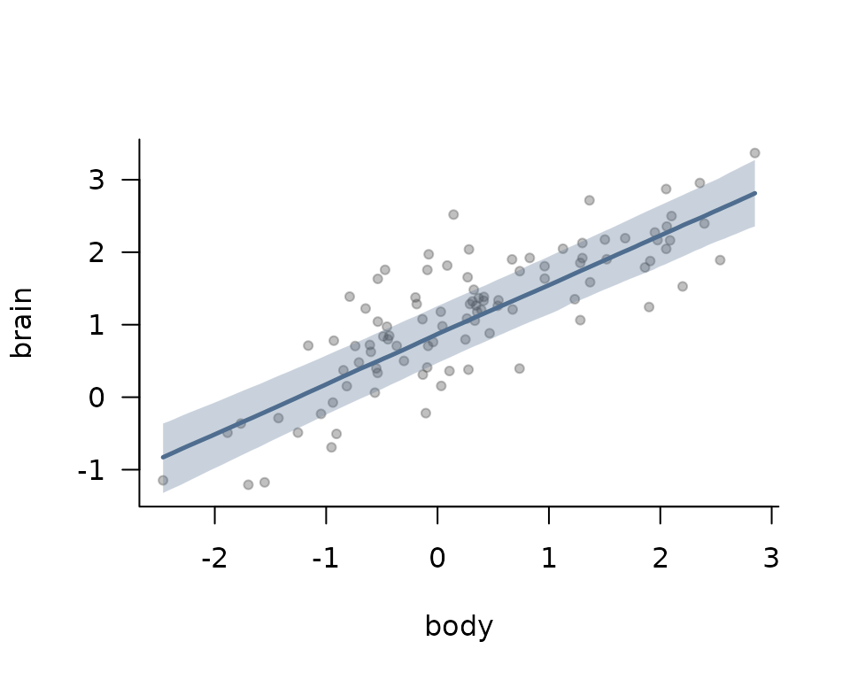
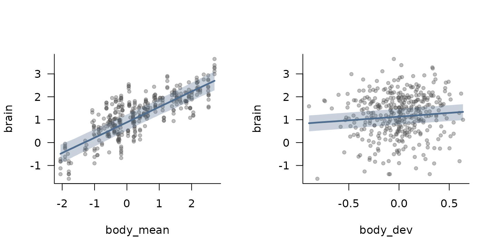
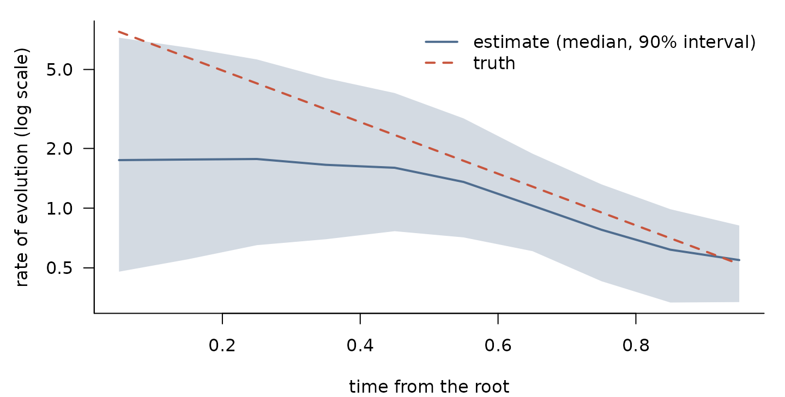
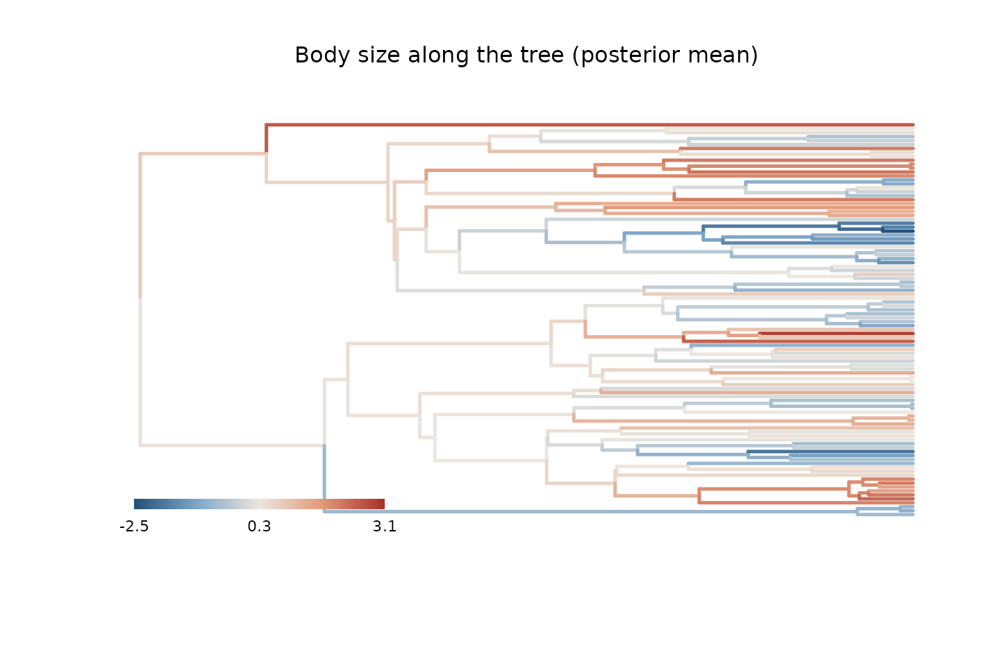

# A tour of models: from Brownian motion to phylogeny plus geography

This vignette walks through the models that `phylogp` can fit, starting
with phylogenetic regression under Brownian motion and adding one idea
at a time: other classical processes, measurement error, several
individuals per species, rates that change through time, geography, and
outlying species. It then shows how to choose among models and how to
predict species without data and ancestral states.

Each section simulates its own data, so the true values are known and we
can see what each model recovers. Every model is a kernel, and moving
from one model to the next only means changing the `kernel` argument of
[`phylo_gp()`](https://thomaspueschel.github.io/phylogp/reference/phylo_gp.md).
All fits use Stan, so the vignette needs `cmdstanr` and CmdStan.

``` r

library(phylogp)
set.seed(2024)
tr <- ape::rphylo(100, birth = 1, death = 0)              # a pure-birth tree
tr$edge.length <- tr$edge.length / max(ape::node.depth.edgelength(tr))  # height 1
N <- ape::Ntip(tr)
```

## 1. Brownian motion and phylogenetic regression

The simplest model of trait evolution is Brownian motion (BM): changes
accumulate at a constant rate along every branch, so the covariance of
two species is proportional to the time they share. Phylogenetic
generalised least squares (PGLS) is a regression whose residuals follow
this process.

We simulate log brain size that scales with log body size (slope 0.7),
with a residual that evolves by BM plus some species-level variation
that is not phylogenetic.

``` r

set.seed(1)
body <- kernel_simulate(k_bm(), tr, pars = list(bm1 = list(sigma = 1.5)))[, 1]
res  <- kernel_simulate(k_bm() + k_white(), tr,
                        pars = list(bm1 = list(sigma = 0.6), white1 = list(sigma = 0.3)))[, 1]
d1 <- data.frame(body = body, brain = 1 + 0.7 * body + res[names(body)])
head(d1, 3)
#>          body       brain
#> t1 -0.9396807 -0.07393112
#> t2  0.0436268  0.97894493
#> t3 -1.2534429 -0.48847486
```

Pure BM
([`k_bm()`](https://thomaspueschel.github.io/phylogp/reference/classical-kernels.md))
is PGLS. Adding
[`k_white()`](https://thomaspueschel.github.io/phylogp/reference/classical-kernels.md),
independent variation of each species, gives the phylogenetic mixed
model, which on a time-calibrated tree is the same model as Pagel’s
$`\lambda`$. Both can be fitted by maximum likelihood:

``` r

fit_bm  <- phylo_gp(brain ~ body, d1, tr, k_bm(), method = "optimize")
fit_bmw <- phylo_gp(brain ~ body, d1, tr, k_bm() + k_white(), method = "optimize")
fit_bmw
#> Phylogenetic Gaussian process
#>   Formula: brain ~ body 
#>   Kernel:  bm() + white() 
#>   Tips:    100 
#>   Likelihood: pruning (linear time) 
#>   Method:  maximum likelihood 
#> 
#>      parameter estimate
#> 1  (Intercept)    0.867
#> 2         body    0.687
#> 3    bm1_sigma    0.497
#> 4 white1_sigma    0.322
#> 
#> log-likelihood: -65.341443
sapply(list(BM = fit_bm, "BM + white" = fit_bmw), function(f) AIC(logLik(f)))
#>         BM BM + white 
#>   190.5519   138.6829
```

or in a Bayesian way, which gives the uncertainty of every parameter.
The proportion of residual variance that is phylogenetic, the
*phylogenetic signal* (equal to Pagel’s $`\lambda`$ here), is a function
of the posterior draws:

``` r

fit1 <- phylo_gp(brain ~ body, d1, tr, k_bm() + k_white())
fit1
#> Phylogenetic Gaussian process
#>   Formula: brain ~ body 
#>   Kernel:  bm() + white() 
#>   Tips:    100 
#>   Likelihood: pruning (linear time) 
#>   Method:  Bayesian (HMC) 
#> 
#>      parameter  mean     sd    q5   q95 rhat ess_bulk
#> 1  (Intercept) 0.864 0.2315 0.486 1.249    1     3703
#> 2         body 0.688 0.0604 0.589 0.787    1     3471
#> 3    bm1_sigma 0.532 0.1042 0.363 0.705    1     2370
#> 4 white1_sigma 0.320 0.0538 0.237 0.412    1     2621

draws <- posterior::as_draws_df(fit1$fit$draws(c("bm1_sigma", "white1_sigma")))
signal <- with(draws, bm1_sigma^2 / (bm1_sigma^2 + white1_sigma^2))
quantile(signal, c(0.05, 0.5, 0.95))
#>        5%       50%       95% 
#> 0.4572182 0.7312588 0.8897449
```

The true signal is $`0.6^2 / (0.6^2 + 0.3^2) = 0.8`$.

[`plot_effects()`](https://thomaspueschel.github.io/phylogp/reference/plot_effects.md)
draws the fitted relationship, the expected brain size at each body
size, with its 90% credible band over the species values. This is the
population-level line, averaged over the phylogenetic and species
effects; the function also returns the values for your own plots.

``` r

plot_effects(fit1, "body")
```



## 2. The classical family

Pagel’s transformations, early burst (EB) and Ornstein–Uhlenbeck (OU)
are all kernels too. With `method = "optimize"` they reproduce `phylolm`
and `geiger` to numerical precision, so a table of the usual models
takes a few lines:

``` r

kernels <- list(BM = k_bm(), "BM + white" = k_bm() + k_white(),
                "Pagel's lambda" = k_lambda(), "Pagel's kappa" = k_kappa(),
                "Pagel's delta" = k_delta(), "early burst" = k_eb(),
                "OU" = k_ou())
classical <- lapply(kernels, function(k) phylo_gp(brain ~ body, d1, tr, k, method = "optimize"))
aic <- sapply(classical, function(f) AIC(logLik(f)))
data.frame(AIC = round(aic, 1), delta = round(aic - min(aic), 1))
#>                  AIC delta
#> BM             190.6  51.9
#> BM + white     138.7   0.0
#> Pagel's lambda 138.7   0.0
#> Pagel's kappa  148.9  10.2
#> Pagel's delta  170.3  31.6
#> early burst    192.6  53.9
#> OU             152.9  14.2
```

The two models with independent species-level variation, “BM + white”
and Pagel’s $`\lambda`$, fit best and equally well: they are the same
model. On a time-calibrated tree, an OU model with a single optimum is
also the same model as an *accelerating* early burst, so their fits
cannot be told apart from extant species alone; see
[`vignette("kernel-design", package = "phylogp")`](https://thomaspueschel.github.io/phylogp/articles/kernel-design.md)
for how to check whether two kernels are the same model.

## 3. Known measurement error

When each species value is a mean with a known standard error, for
example from a meta-analysis, the standard errors enter the model
through `se`. They are added to the variance of each species, so
precisely measured species count for more.

``` r

set.seed(3)
d3 <- d1
d3$se <- runif(N, 0.05, 0.6)
d3$brain <- d3$brain + rnorm(N, 0, d3$se)

fit3 <- phylo_gp(brain ~ body, d3, tr, k_bm() + k_white(), se = "se")
fit3
#> Phylogenetic Gaussian process
#>   Formula: brain ~ body 
#>   Kernel:  bm() + white() 
#>   Tips:    100 
#>   Likelihood: pruning (linear time) 
#>   Method:  Bayesian (HMC) 
#> 
#>      parameter  mean     sd    q5   q95 rhat ess_bulk
#> 1  (Intercept) 0.906 0.2248 0.533 1.275    1     2603
#> 2         body 0.718 0.0684 0.605 0.826    1     3246
#> 3    bm1_sigma 0.480 0.1297 0.269 0.695    1     1651
#> 4 white1_sigma 0.365 0.0727 0.243 0.485    1     2097
```

The estimates are close to those from the data without measurement
error, with somewhat wider intervals.

## 4. Several individuals per species

Data often come as individuals rather than species means. Keep one row
per individual and give the column of species names in `species`. The
kernel then describes the species,
[`k_white()`](https://thomaspueschel.github.io/phylogp/reference/classical-kernels.md)
becomes the non-phylogenetic species effect, and a residual standard
deviation within species, `within_sigma`, is added. The likelihood is
exact and stays linear in the number of species.

Here we sample one to six individuals per species. Body size varies
within species, and the within-species slope is 0.3, smaller than the
slope among species (0.7). Splitting the predictor into the species mean
and the deviation from it estimates both slopes:

``` r

set.seed(4)
ind <- data.frame(species = rep(rownames(d1), sample(1:6, N, replace = TRUE)))
dev <- rnorm(nrow(ind), 0, 0.3)
ind$body  <- d1[ind$species, "body"] + dev
ind$brain <- d1[ind$species, "brain"] + 0.3 * dev + rnorm(nrow(ind), 0, 0.2)
ind$body_mean <- ave(ind$body, ind$species)
ind$body_dev  <- ind$body - ind$body_mean
nrow(ind)
#> [1] 374

fit4 <- phylo_gp(brain ~ body_mean + body_dev, ind, tr, k_bm() + k_white(),
                 species = "species")
fit4
#> Phylogenetic Gaussian process
#>   Formula: brain ~ body_mean + body_dev 
#>   Kernel:  bm() + white() 
#>   Tips:    100 (374 rows; within-species sd: within_sigma) 
#>   Likelihood: pruning (linear time) 
#>   Method:  Bayesian (HMC) 
#> 
#>      parameter  mean      sd    q5   q95 rhat ess_bulk
#> 1  (Intercept) 0.885 0.21443 0.528 1.235    1     4286
#> 2    body_mean 0.671 0.05624 0.579 0.764    1     5949
#> 3     body_dev 0.326 0.03757 0.265 0.387    1     5091
#> 4    bm1_sigma 0.476 0.10694 0.307 0.655    1     3068
#> 5 white1_sigma 0.344 0.05499 0.253 0.434    1     3532
#> 6 within_sigma 0.198 0.00862 0.184 0.213    1     5443
```

The two panels of
[`plot_effects()`](https://thomaspueschel.github.io/phylogp/reference/plot_effects.md)
show the steep relationship among species and the shallower one within
species, over the individual data:

``` r

plot_effects(fit4)
```



The points are the raw individual values, so in the right panel they
still include the differences among species, which is why they scatter
widely around the shallow within-species line.

Leave-one-out cross-validation then leaves out whole species, and
`predict(type = "response")` predicts a new individual.

## 5. Rates that change through time

Early burst assumes that the rate of evolution declines exponentially. A
more flexible alternative lets the rate vary smoothly through time:
[`k_rate_time()`](https://thomaspueschel.github.io/phylogp/reference/k_rate_time.md)
divides the height of the tree into bins and gives each a log rate with
a random-walk prior. We simulate an early burst, in which the rate falls
20-fold from the root to the present, and see whether the flexible
kernel recovers its shape without being told.

``` r

set.seed(5)
r_eb <- -log(20)                                    # rate at time t: exp(r_eb * t)
y5 <- kernel_simulate(k_eb() + k_white(), tr,
                      pars = list(eb1 = list(sigma = 3, rate = r_eb),
                                  white1 = list(sigma = 0.05)))[, 1]
d5 <- data.frame(y = y5)
fit5 <- phylo_gp(y ~ 1, d5, tr, k_rate_time(n_bins = 10) + k_white())
```

``` r

rt <- rate_through_time(fit5)
mid <- (rt$start + rt$end) / 2
true <- 3^2 * exp(r_eb * mid)                      # sigma^2 times the relative rate
op <- par(mar = c(4, 4.5, 1, 1))
plot(mid, rt$median, log = "y", type = "n", las = 1, bty = "l",
     ylim = range(rt$q5, rt$q95, true), xlab = "time from the root",
     ylab = "rate of evolution (log scale)")
polygon(c(mid, rev(mid)), c(rt$q5, rev(rt$q95)), col = adjustcolor(cols["blue"], 0.25), border = NA)
lines(mid, rt$median, lwd = 2, col = cols["blue"])
lines(mid, true, lwd = 2, lty = 2, col = cols["red"])
legend("topright", c("estimate (median, 90% interval)", "truth"),
       col = cols[c("blue", "red")], lty = 1:2, lwd = 2, bty = "n")
```



``` r

par(op)
```

The estimated rates decline towards the present, as in the simulation,
without the exponential shape being assumed. Early in the history of the
tree there are few branches to learn from, so the estimates there are
uncertain and pulled towards a constant rate by the random-walk prior:
the early decline is underestimated, and only the first interval misses
the truth. For rates that vary among clades rather than through time,
see
[`k_relaxed()`](https://thomaspueschel.github.io/phylogp/reference/k_relaxed.md)
in
[`vignette("phylogp", package = "phylogp")`](https://thomaspueschel.github.io/phylogp/articles/phylogp.md).

## 6. Phylogeny and geography

Closely related species are often also close in space, and a trait can
vary with geography for reasons that have nothing to do with ancestry.
[`k_dist()`](https://thomaspueschel.github.io/phylogp/reference/k_dist.md)
adds a Gaussian process over any distance matrix, here the distances
between species’ range centres, so the phylogenetic and the spatial
variation are estimated together.

We place the species on a map, with relatives tending to live near each
other, and simulate a trait with phylogenetic, spatial and independent
parts.

``` r

set.seed(6)
xy <- kernel_simulate(k_bm(), tr, nsim = 2)          # range centres, phylogenetically clustered
xy <- xy + matrix(rnorm(2 * N, 0, 0.6), N)           # plus some dispersal
D <- as.matrix(dist(xy))                             # tip labels as row names
K_space <- exp(-D / 1.5)                             # exponential kernel, length scale 1.5
space <- drop(t(chol(K_space + diag(1e-8, N))) %*% rnorm(N))
y6 <- kernel_simulate(k_bm() + k_white(), tr,
                      pars = list(bm1 = list(sigma = 0.7), white1 = list(sigma = 0.3)))[, 1]
d6 <- data.frame(y = y6[rownames(D)] + 0.8 * space, row.names = rownames(D))
```

``` r

fit6_phy   <- phylo_gp(y ~ 1, d6, tr, k_bm() + k_white())
fit6_space <- phylo_gp(y ~ 1, d6, tr, k_bm() + k_dist(D) + k_white())
fit6_space
#> Phylogenetic Gaussian process
#>   Formula: y ~ 1 
#>   Kernel:  bm() + dist(D, exponential) + white() 
#>   Tips:    100 
#>   Likelihood: dense 
#>   Method:  Bayesian (HMC) 
#> 
#>      parameter  mean    sd      q5   q95 rhat ess_bulk
#> 1  (Intercept) 0.110 0.550 -0.7122 0.953    1     1576
#> 2    bm1_sigma 0.562 0.107  0.3931 0.746    1     2309
#> 3  dist1_sigma 0.835 0.322  0.4924 1.500    1     1134
#> 4    dist1_ell 1.760 2.034  0.3688 5.749    1     1023
#> 5 white1_sigma 0.229 0.131  0.0243 0.448    1     1382
```

The spatial component (`dist1`) is a dense kernel, so this model costs
$`O(N^3)`$ per evaluation instead of $`O(N)`$; for a few hundred species
that is still fast. Its standard deviation is close to the true 0.8. The
length scale `ell` is poorly determined with 100 species (its interval
is wide, although it contains the true 1.5), which is typical for
spatial processes. Leave-one-out cross-validation clearly prefers the
model with geography:

``` r

loo::loo_compare(list("phylogeny only" = loo(fit6_phy),
                      "phylogeny + geography" = loo(fit6_space)))
#>                  model elpd_diff se_diff p_worse diag_diff diag_elpd
#>  phylogeny + geography       0.0     0.0      NA                    
#>         phylogeny only     -16.1     4.8    1.00
```

The exponential kernel used here is valid for any Euclidean distance and
for great-circle distances on the sphere;
[`kernel_check()`](https://thomaspueschel.github.io/phylogp/reference/kernel_check.md)
tests other choices on the data at hand.

## 7. Outlying species

A few species far from the rest can pull a Gaussian regression. With
`k_white(df = 4)` the species-level residual follows a Student-t
distribution with 4 degrees of freedom, which down-weights them. We add
five outliers to the data of section 1:

``` r

d7 <- d1
out <- sample(N, 5)
d7$brain[out] <- d7$brain[out] + c(-1, 1, -1, 1, 1) * 2.5

fit7_gauss <- phylo_gp(brain ~ body, d7, tr, k_bm() + k_white())
fit7_t     <- phylo_gp(brain ~ body, d7, tr, k_bm() + k_white(df = 4))
rbind(Gaussian = summary(fit7_gauss)[2, c("mean", "q5", "q95")],
      "Student-t" = summary(fit7_t)[2, c("mean", "q5", "q95")])
#>                mean        q5       q95
#> Gaussian  0.7516517 0.6104744 0.8970566
#> Student-t 0.7139526 0.6101820 0.8190757
```

The slope (true value 0.7) and the other parameters are less affected by
the outliers under the Student-t residual. See
[`vignette("slopes-prediction", package = "phylogp")`](https://thomaspueschel.github.io/phylogp/articles/slopes-prediction.md)
for more on robust residuals and on slopes that themselves evolve along
the tree.

## 8. Choosing among models

Leave-one-out cross-validation (LOO) compares models by how well they
predict each species from all the others. For branch-wise kernels the
leave-one-out densities are computed in linear time, and
[`loo()`](https://mc-stan.org/loo/reference/loo.html) returns the usual
Pareto-smoothed estimate:

``` r

fit1_bm <- phylo_gp(brain ~ body, d1, tr, k_bm())
fit1_ou <- phylo_gp(brain ~ body, d1, tr, k_ou() + k_white())
loo::loo_compare(list("BM" = loo(fit1_bm), "BM + white" = loo(fit1),
                      "OU + white" = loo(fit1_ou)))
#>       model elpd_diff se_diff p_worse       diag_diff      diag_elpd
#>  BM + white       0.0     0.0      NA                               
#>  OU + white      -0.4     1.0    0.67 |elpd_diff| < 4 2 k_psis > 0.7
#>          BM     -34.5    17.8    0.97                 2 k_psis > 0.7
```

Pure BM predicts much worse than the models with species-level
variation, while OU adds nothing to BM plus white noise. The diagnostics
flag a couple of species whose Pareto $`\hat k`$ exceeds 0.7, meaning
their importance sampling estimate is unreliable;
[`loo_refit()`](https://thomaspueschel.github.io/phylogp/reference/loo_refit.md)
refits the model without each of them and replaces the estimate by the
exact value (see
[`vignette("slopes-prediction", package = "phylogp")`](https://thomaspueschel.github.io/phylogp/articles/slopes-prediction.md)).

Leaving out one species at a time mostly asks how well a species is
predicted from its closest relatives. Leaving out whole clades asks
something harder: how well the model predicts a group it has not seen.
[`loo_group()`](https://thomaspueschel.github.io/phylogp/reference/loo_group.md)
refits the model without each group and scores the group’s joint
predictive density; the result can be compared with `loo_compare()` as
well.

``` r

clades <- cutree(as.hclust(tr), k = 7)               # seven clades
table(clades)
#> clades
#>  1  2  3  4  5  6  7 
#>  3 23 24 30  8 11  1
lg_bm  <- loo_group(fit1_bm, clades)
lg_bmw <- loo_group(fit1, clades)
loo::loo_compare(list("BM" = lg_bm, "BM + white" = lg_bmw))
#>       model elpd_diff se_diff p_worse diag_diff diag_elpd
#>  BM + white       0.0     0.0      NA                    
#>          BM     -25.0    15.3    0.95   N < 100
```

A model whose advantage disappears when whole clades are left out may be
fitting the relationships within clades rather than the process across
the tree.

## 9. Prediction and ancestral states

A fitted model predicts species that are in the tree but have no data,
by conditioning the Gaussian process on the observed species. We leave
out five species and predict them from their body size:

``` r

missing <- sample(rownames(d1), 5)
fit9 <- phylo_gp(brain ~ body, d1[!rownames(d1) %in% missing, ], tr,
                 k_bm() + k_white())
p <- predict(fit9, newdata = d1[missing, ], tree = tr)
cbind(p[, c("species", "mean", "q5", "q95")], true = d1[missing, "brain"])
#>   species       mean           q5         q95       true
#> 1     t31  2.2887568  1.452843046  3.18466261  2.3543451
#> 2     t91  0.7733394 -0.015971361  1.58290030  0.7208392
#> 3     t79 -0.7477280 -1.417464313 -0.03630258 -0.3638477
#> 4     t48  0.8087231 -0.001191137  1.52776729  0.8384882
#> 5     t97  0.6816089 -0.153634129  1.45359702  1.3873117
```

For intercept-only models of a process along the whole tree,
[`ancestral()`](https://thomaspueschel.github.io/phylogp/reference/ancestral.md)
reconstructs the trait at the internal nodes, again in linear time. Here
we reconstruct body size and colour the tree by the posterior medians:

``` r

fit_body <- phylo_gp(body ~ 1, d1, tr, k_bm())
anc <- ancestral(fit_body, tips = TRUE)
head(anc[anc$node > N, ], 3)
#>     node      mean        sd          q5      q95
#> 101  101 0.5933526 0.5471136 -0.28459322 1.451125
#> 102  102 0.7778208 0.4885844 -0.02604714 1.568308
#> 103  103 0.3475985 0.4361507 -0.38323955 1.040291
ft <- fit_body$tree
plot_tree_values(ft, anc$mean[match(ft$edge[, 2], anc$node)],
                 main = "Body size along the tree (posterior mean)")
```



## Where next

- [`vignette("phylogp", package = "phylogp")`](https://thomaspueschel.github.io/phylogp/articles/phylogp.md):
  a full analysis with rates that vary among branches
  ([`k_relaxed()`](https://thomaspueschel.github.io/phylogp/reference/k_relaxed.md)).
- [`vignette("kernel-design", package = "phylogp")`](https://thomaspueschel.github.io/phylogp/articles/kernel-design.md):
  building your own kernels, checking that they are valid, and telling
  whether two kernels are the same model.
- [`vignette("slopes-prediction", package = "phylogp")`](https://thomaspueschel.github.io/phylogp/articles/slopes-prediction.md):
  slopes that evolve along the tree, influential species and robust
  residuals.
