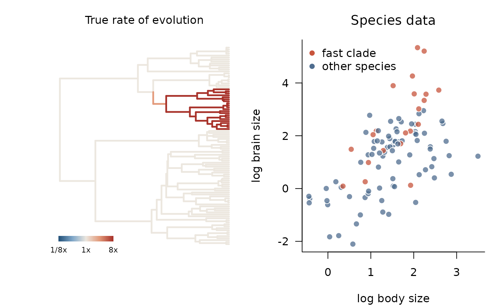
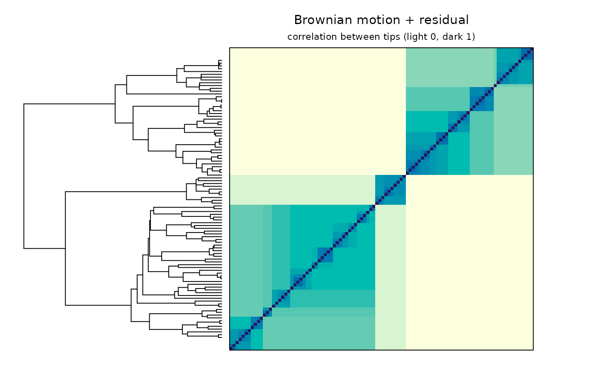
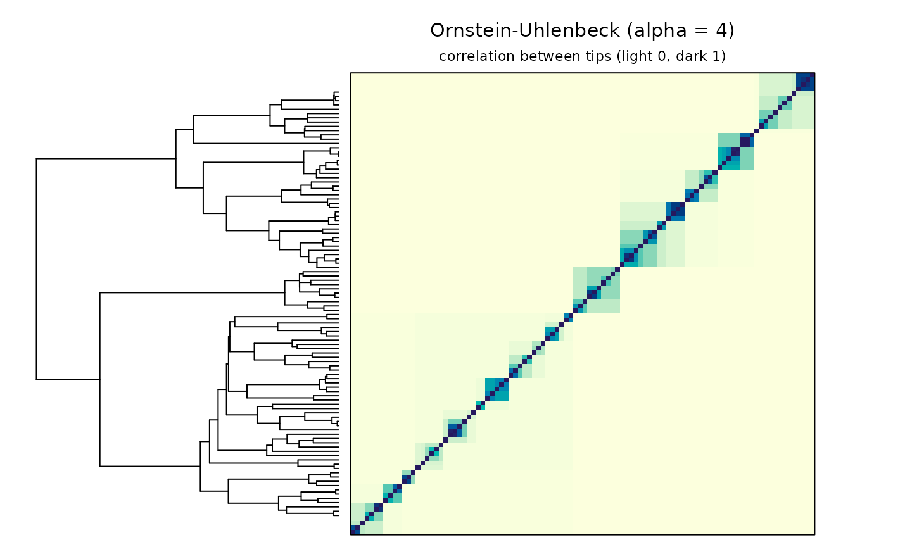
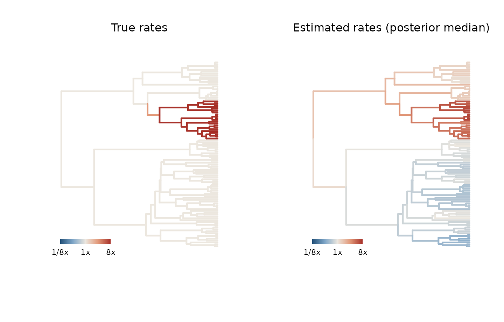
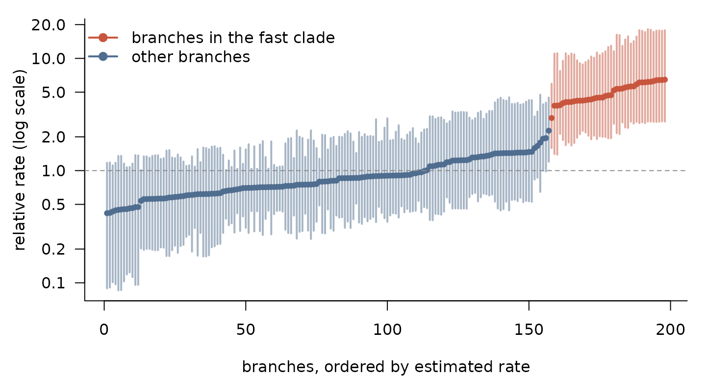

# Getting started with phylogp

Every Gaussian model of continuous trait evolution, from Brownian motion
and Pagel’s λ to Ornstein–Uhlenbeck, early-burst and multi-rate models,
says the same thing about the data:

``` math
 y \sim \mathcal{N}(X\beta,\; K), 
```

and the models differ only in the covariance matrix $`K`$, the
**kernel**. In `phylogp` you build a model by adding kernel components,
and the package writes, compiles and fits the corresponding Stan
program.

This tutorial walks through a complete analysis of simulated data in
which one clade evolves much faster than the rest of the tree. We will

1.  look at what different kernels assume,
2.  fit the classical models by maximum likelihood,
3.  fit a *relaxed-rate* kernel that lets the rate of evolution itself
    evolve along the tree, and compare models by leave-one-out
    cross-validation, and
4.  map the estimated rates back onto the tree.

## Simulated data: a clade that evolves fast

We simulate a time-calibrated tree of 100 species, scaled to height 1,
and pick a clade of about 20 species.

``` r

library(phylogp)
set.seed(13)

tr <- ape::rphylo(100, birth = 1, death = 0)     # a pure-birth tree
tr$edge.length <- tr$edge.length / max(ape::node.depth.edgelength(tr))

N <- ape::Ntip(tr)
clade_sizes <- lengths(ape::prop.part(tr))       # tips below each internal node
fast_node <- N + which.min(abs(clade_sizes - 20))

descendants <- function(node) {
  kids <- tr$edge[tr$edge[, 1] == node, 2]
  c(node, unlist(lapply(kids, descendants)))
}
in_clade <- descendants(fast_node)
fast_tips <- tr$tip.label[intersect(in_clade, seq_len(N))]
length(fast_tips)
#> [1] 21
```

Within that clade, a trait evolves 8 times faster than elsewhere. We
express this with the log-rate path `z` used by
[`k_relaxed()`](https://thomaspueschel.github.io/phylogp/reference/k_relaxed.md):
the rate of an edge is `exp((z_start + z_end) / 2)`, so setting
`z = log(8)` on every node of the clade gives an 8-fold rate inside it.

The response, say brain size, scales with body size (slope 0.7) and has
a residual that evolves with these rates, plus a little species-level
noise.

``` r

z <- numeric(N + tr$Nnode)
z[in_clade] <- log(8)
true_rates <- exp(0.5 * (z[tr$edge[, 1]] + z[tr$edge[, 2]]))

body  <- kernel_simulate(k_bm(), tr, pars = list(bm1 = list(sigma = 1.5)))[, 1]
resid <- kernel_simulate(k_relaxed() + k_white(), tr,
                         pars = list(relaxed1 = list(sigma = 1, z = z),
                                     white1   = list(sigma = 0.1)))[, 1]
d <- data.frame(body = body, brain = 0.5 + 0.7 * body + resid[names(body)])
head(d)
#>          body       brain
#> t1  2.2864931  3.57470177
#> t2  0.9728937  2.77482865
#> t3 -0.4241827 -0.38686205
#> t4  0.8656091 -0.34098188
#> t5  2.0111909  3.58599000
#> t6  1.5234227  0.09569618
```

``` r

op <- par(mfrow = c(1, 2), mar = c(4, 4, 3, 1))
plot_tree_rates(tr, true_rates, lim = 3, main = "True rate of evolution")
fast <- rownames(d) %in% fast_tips
plot(brain ~ body, data = d, pch = 21, cex = 1.2,
     bg = adjustcolor(ifelse(fast, pal["fast"], pal["other"]), 0.75),
     col = "white", las = 1, bty = "l", xlab = "log body size",
     ylab = "log brain size", main = "Species data", font.main = 1)
legend("topleft", c("fast clade", "other species"), pt.bg = pal[1:2],
       pch = 21, col = "white", pt.cex = 1.2, bty = "n")
```



``` r

par(op)
```

## What does a kernel assume?

Before fitting anything,
[`kernel_plot()`](https://thomaspueschel.github.io/phylogp/reference/kernel_plot.md)
shows the correlation between species that a kernel implies. Tips are in
the same order in the tree and in the matrix, so clades appear as
blocks.

``` r

kernel_plot(k_bm() + k_white(), tr,
            pars = list(white1 = list(sigma = 0.5)),
            main = "Brownian motion + residual")
```



An Ornstein–Uhlenbeck kernel with strong selection forgets deep history:
only close relatives remain correlated.

``` r

kernel_plot(k_ou(), tr, pars = list(ou1 = list(alpha = 4)),
            main = "Ornstein-Uhlenbeck (alpha = 4)")
```



## Classical models by maximum likelihood

With `method = "optimize"`,
[`phylo_gp()`](https://thomaspueschel.github.io/phylogp/reference/phylo_gp.md)
finds maximum-likelihood estimates; for the classical kernels these
agree with `phylolm` to numerical precision.

``` r

classical <- list(BM = k_bm(), "Pagel's lambda" = k_lambda(),
                  OU = k_ou(), "Early burst" = k_eb())
ml <- lapply(classical, function(k)
  phylo_gp(brain ~ body, data = d, tree = tr, kernel = k, method = "optimize"))

knitr::kable(data.frame(
  logLik = sapply(ml, function(f) as.numeric(logLik(f))),
  AIC    = sapply(ml, AIC),
  slope  = sapply(ml, function(f) coef(f)[["body"]])
), digits = 2)
```

|                |  logLik |    AIC | slope |
|:---------------|--------:|-------:|------:|
| BM             | -100.26 | 206.51 |  0.86 |
| Pagel’s lambda |  -96.28 | 200.55 |  0.86 |
| OU             |  -97.65 | 203.30 |  0.87 |
| Early burst    | -100.26 | 208.51 |  0.86 |

All four overestimate the slope (the true value is 0.7): none of them
can represent a rate that differs between clades, so the large residuals
of the fast clade, whose species sit at the upper end of body size, pull
the regression line upwards.

## A kernel whose rate evolves

[`k_relaxed()`](https://thomaspueschel.github.io/phylogp/reference/k_relaxed.md)
lets the log rate of evolution follow a Brownian motion along the tree,
without being told where any shift lies. Its rates are latent variables,
so it is fitted by Hamiltonian Monte Carlo. We compare it with the
Bayesian version of the Pagel’s λ model (BM plus residual).

``` r

fit_bm      <- phylo_gp(brain ~ body, data = d, tree = tr,
                        kernel = k_bm() + k_white(), seed = 1)
fit_relaxed <- phylo_gp(brain ~ body, data = d, tree = tr,
                        kernel = k_relaxed() + k_white(), seed = 1)
fit_relaxed
#> Phylogenetic Gaussian process
#>   Formula: brain ~ body 
#>   Kernel:  relaxed() + white() 
#>   Tips:    100 
#>   Likelihood: pruning (linear time) 
#>   Method:  Bayesian (HMC) 
#> 
#>        parameter   mean    sd      q5   q95 rhat ess_bulk
#> 1    (Intercept) -0.157 0.734 -1.3699 1.008    1     9059
#> 2           body  0.695 0.103  0.5316 0.866    1     8759
#> 3 relaxed1_sigma  1.484 0.458  0.8665 2.313    1     4394
#> 4   relaxed1_tau  1.166 0.361  0.6530 1.794    1     2680
#> 5   white1_sigma  0.107 0.048  0.0301 0.192    1     2929
```

`relaxed1_tau`, the standard deviation of log-rate change, is clearly
above zero: the data favour variable rates.

Leave-one-out cross-validation asks which model predicts each species
better from all the others. `phylogp` computes the exact conditional
densities $`p(y_i \mid y_{-i}, \theta)`$ in linear time, and
[`loo()`](https://mc-stan.org/loo/reference/loo.html) combines them
across posterior draws.

``` r

loo::loo_compare(list("BM + residual"      = loo(fit_bm),
                      "relaxed + residual" = loo(fit_relaxed)))
#> Warning: Some Pareto k diagnostic values are too high. See help('pareto-k-diagnostic') for details.
#>               model elpd_diff se_diff p_worse diag_diff      diag_elpd
#>  relaxed + residual       0.0     0.0      NA           2 k_psis > 0.7
#>       BM + residual     -20.8     6.2    1.00
#> 
#> Diagnostic flags present.
#> See ?`loo-glossary` (sections `diag_diff` and `diag_elpd`)
#> or https://mc-stan.org/loo/reference/loo-glossary.html.
```

The relaxed-rate kernel predicts left-out species clearly better, and
its slope estimate is close to the true 0.7. The flags report species
with Pareto $`\hat k > 0.7`$, for which the importance-sampling
approximation is unreliable; these are influential species, often in the
fast clade. In a real analysis, recompute their contributions exactly by
refitting without them before drawing conclusions.

## Where did the rate change?

[`plot_edge_rates()`](https://thomaspueschel.github.io/phylogp/reference/plot_edge_rates.md)
colours every branch by its posterior median rate, relative to a typical
branch.

``` r

op <- par(mfrow = c(1, 2))
plot_tree_rates(tr, true_rates, lim = 3, main = "True rates")
plot_edge_rates(fit_relaxed, lim = 3, main = "Estimated rates (posterior median)")
```



``` r

par(op)
```

The fast clade is recovered without any prior information about its
location.
[`edge_rates()`](https://thomaspueschel.github.io/phylogp/reference/edge_rates.md)
returns the numbers, with 90% intervals:

``` r

er <- edge_rates(fit_relaxed)
ft <- fit_relaxed$tree
er$fast <- er$child %in% in_clade
er <- er[order(er$median), ]

op <- par(mar = c(4, 4.5, 1, 1))
plot(seq_len(nrow(er)), er$median, log = "y", type = "n", las = 1, bty = "l",
     ylim = range(er$q5, er$q95), xlab = "branches, ordered by estimated rate",
     ylab = "relative rate (log scale)")
segments(seq_len(nrow(er)), er$q5, y1 = er$q95,
         col = adjustcolor(ifelse(er$fast, pal["fast"], pal["other"]), 0.5), lwd = 2)
points(seq_len(nrow(er)), er$median, pch = 19, cex = 0.7,
       col = ifelse(er$fast, pal["fast"], pal["other"]))
abline(h = 1, lty = 2, col = pal["grey"])
legend("topleft", c("branches in the fast clade", "other branches"),
       col = pal[1:2], pch = 19, lwd = 2, bty = "n")
```



``` r

par(op)
```

The autocorrelated prior smooths an abrupt shift, so the size of the
change is underestimated (the truth is 8-fold) even though its location
is found. This is the expected behaviour of the model, and the reason to
read the estimated ratio as conservative.

## Under the hood

Each kernel component adds its contribution to the variance accumulated
along every branch. When all components have this branch-wise form, the
likelihood is evaluated by the linear-time pruning recursion. You can
inspect, and edit, the generated program:

``` r

code <- strsplit(stancode(fit_relaxed), "\n")[[1]]
cat(code[grep("^model", code):(grep("^generated", code) - 1)], sep = "\n")
#> model {
#>   {
#>     vector[E] w = rep_vector(0, E);
#>     real rv = 0;
#>     vector[N] t2 = square(se);
#>     // relaxed()
#>     {
#>     w += square(relaxed1_sigma) * (exp(0.5 * (relaxed1_z[anc] + relaxed1_z[des])) .* len);
#>   }
#>     t2 += square(white1_sigma);
#>     vector[N] r = y - X * coefs;
#>     target += tree_pruning_lpdf(r | w, rv, t2, anc, des, first_child, n_nodes, root);
#>   }
#>   relaxed1_eta ~ std_normal();
#>   if (use_prior == 1) {
#>     coefs ~ normal(0, prior_beta_scale);
#>     relaxed1_sigma ~ normal(0, relaxed1_sigma_scale);
#>     relaxed1_tau ~ normal(0, relaxed1_tau_scale);
#>     white1_sigma ~ normal(0, white1_sigma_scale);
#>   }
#> }
```

[`make_stancode()`](https://thomaspueschel.github.io/phylogp/reference/make_stancode.md)
produces the same program without fitting, and
[`make_standata()`](https://thomaspueschel.github.io/phylogp/reference/make_standata.md)
the matching data, so a model can be taken further in `cmdstanr`
directly.

## Next steps

- [`vignette("kernel-design", package = "phylogp")`](https://thomaspueschel.github.io/phylogp/articles/kernel-design.md)
  shows how to build and check your own kernels, including when a kernel
  is or is not a valid covariance on a tree with fossil tips.
- `?classical-kernels` lists the built-in components.
